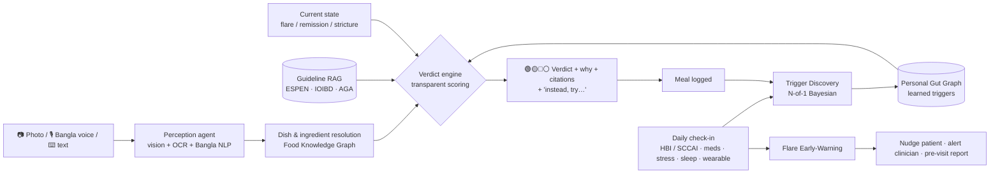

# Step 1: Strategy, Scope and Winning Plan

> Status: **Draft v0.1** (2026-09-24) · Owner: Team Leader · Next review: after the team answers the open questions in §10

This is the first planning step. It takes the current HappyGut concept, tests it the way a judge, a gastroenterologist and an ML engineer would, and turns it into a scoped plan. The later steps (architecture, data, build, demo) all build on the decisions made here.

---

## 1. Where we stand

| Item | Reality | Implication |
|---|---|---|
| Calendar | 2026-09-24. Phase 2 ("Build & Prototype") ends Sep 30. **Preliminary deadline is Oct 31, about 5 weeks away.** | We're behind the official phase plan. Every week from now on has to produce something that works. |
| Code | Empty repository | Architecture and scope decisions have to be made this week. |
| Portal score | "Basics" section is complete. Data stack, AI detail, links and provenance are all at **0** | Most of the remaining points come from real components that are *documented*. They follow from the build if we write things down as we go. |
| Judging | 5 × 20 pts: Innovation, Technical, Business, Scale/Impact, Responsible AI + Presentation | The 180s video decides whether we reach the finals, so the demo has to be designed first (§7). |

**The guiding principle comes from the guide itself:** *"Focus on one core use case; make it work perfectly"* and *"You are judged on your ability to execute."*

---

## 2. Stress test of the current concept

These are the questions a sharp judge will ask. Each one is paired with the fix.

### 2.1 A "Safe / Warning" verdict is a medical-safety liability
Telling an IBD patient a food is **"Safe"** is a claim no system can guarantee. HealthSphere is explicitly flagged for *"extra rigor on accuracy and public safety."*

**Fix: use a graded, explained, personal verdict. The app never says "safe".**

| Verdict | Meaning |
|---|---|
| 🟢 **Likely OK for you** | Low-risk components *and* no negative personal history |
| 🟡 **Caution** | Risky only in some contexts (portion, preparation, current flare state). Comes with a concrete tip |
| 🔴 **Likely trigger for you** | Strong guideline evidence or strong personal evidence |
| ⚪ **Not sure** | Low confidence (unclear photo, unknown dish). Asks a clarifying question instead of guessing |

Every verdict shows **why** (three evidence types, §3.2), a **confidence** level, and an **"instead, try…"** alternative.

### 2.2 Low-FODMAP isn't *the* IBD diet
Low-FODMAP has good evidence for **IBS-like functional symptoms in *quiescent* IBD** (e.g., Cox et al., *Gastroenterology* 2020). It doesn't treat inflammation. If the knowledge base is "Low-FODMAP", a gastroenterologist on the panel will spot the gap immediately.

**Fix: build the knowledge base on IBD-specific guidance, with FODMAP as one layer of it:**
- ESPEN guideline on clinical nutrition in IBD (2023 update)
- IOIBD dietary guidance (Levine et al., *Clin Gastroenterol Hepatol* 2020)
- AGA Clinical Practice Update on diet & nutritional therapies in IBD (2024)
- Phenotype-specific rules. The critical one is **stricturing Crohn's → avoid insoluble fibre, skins, seeds, nuts** (obstruction risk). This is a genuine safety rule and it scores well with judges.
- FODMAP composition data from **published papers only**. Monash University's FODMAP database is proprietary, and scraping it would break the "legally sourced data" rule.

### 2.3 Flare prediction without data is the weakest claim in the deck
"Time-series ML predicts flare-ups" raises an obvious question: *trained on what?* No public dataset has daily IBD diet and symptom logs.

**Fix: split it into two honest, demonstrable engines:**
1. **Personal Trigger Discovery (the core innovation).** An N-of-1 Bayesian model estimates, for each food component, the probability that *this* patient gets symptoms 6–48h after exposure. Population priors come from the guidelines, and the model adjusts for stress, sleep, missed doses and menstrual cycle. It works from a few weeks of logs and explains itself.
2. **Flare Early-Warning Score.** v0 is a transparent score built on **validated clinical indices**: Harvey-Bradshaw Index (Crohn's) and SCCAI (UC). It adds adherence, symptom trend and optional wearable signals (resting HR, HRV, sleep). Mount Sinai's wearable research reported physiological changes preceding IBD flares *(verify exact citation before quoting)*. v1 is gradient boosting with SHAP explanations. v2 is federated training on consented real users.

**Validation trick:** we build a **synthetic cohort with triggers we injected ourselves**, for example 500 patients × 180 days. Because we know the ground truth, we can *measure* how well the engine recovers each patient's real triggers (precision/recall, days-to-detection). That's a rigorous evaluation even before we have real users. It must always be labelled "simulated" (the rules prohibit fabricated results).

### 2.4 The Federated Learning story contradicts itself
The current text says PII is stripped on-device *and then* de-identified data is aggregated into a cloud database "via Federated Learning". In federated learning **data never leaves the device; only model updates do.** Uploading de-identified records is centralised collection. Any ML judge will catch this.

**Fix: tell three clearly separated stories:**
1. **Raw health data stays under the patient's control.** It lives on the device or in an in-region, row-level-secured store, with PII removed by a *local* model before anything reaches a cloud LLM.
2. **Federated learning** improves the shared population priors (trigger priors, flare model) from **model updates only**, with secure aggregation and differential privacy. For the preliminary round this is a **Flower simulation**, labelled as such.
3. **Research data lakehouse**: only **consented, aggregated, k-anonymised / differentially private statistics**, such as "fried street food → symptom rate, Dhaka, n=1,240". This is what researchers query.

### 2.5 Bangladeshi meals mostly don't have labels
The concept is built around ingredient labels, but most meals in Bangladesh are home-cooked or restaurant food: bhat, dal, bhorta, machher jhol, biryani, fuchka.

**Fix: support three input modes, in this priority order:**
1. **Dish photo → dish recognition → ingredient and preparation inference** from a **Bangladeshi Food Knowledge Graph** (this is the differentiator)
2. **Package label photo → OCR** of Bangla and English ingredient lists
3. **Bangla / English / Banglish voice or text**, e.g. *"ajke dupure kacchi khaisi"* ("I ate kacchi for lunch today"). This lowers the literacy barrier.

### 2.6 The ChronicCare loop needs a clinician side
The challenge's winning signal is *"wearable/data ingestion + alerts + coaching → sustained outcomes."* A patient-only app misses the "remote monitoring" half.

**Fix:** add a **clinician pre-visit report**: a one-page summary of symptom trend, adherence, discovered triggers and flare-risk history, shared by the patient with a QR code. It's the second half of the ChronicCare loop, and hospitals and clinics are who would pay for it (§6).

### 2.7 Too many features, and none of them finished yet
Four "layers" plus FL plus bilingual NLP in 5 weeks invites mistake #7 (overbuilding).

**Fix: pick one hero flow.** Everything else exists to make that flow smarter (§4).

---

## 3. Positioning

### 3.1 One-liner (proposed)
> **HappyGut learns what *your* gut tolerates. Snap any meal, in Bangla or English, and in seconds see whether it's likely to trigger *you*, why, and what to eat instead. It also warns you and your doctor before a flare builds.**

### 3.2 The non-obvious innovation: the *Personal Gut Graph*
Generic diet apps say what's bad **for IBD patients**. HappyGut learns what's bad **for this patient**, and can show its reasoning.

- A **clinical knowledge graph** links foods (Bangladeshi dishes first) → ingredients → components (lactose, fructans, insoluble fibre, fat, capsaicin, alcohol…) → mechanisms → guideline evidence.
- Each patient gets a **personal subgraph**: `(:Patient)-[:REACTS_TO {p, n, ci, last_seen}]->(:Component)` edges, which the Trigger Discovery engine updates continuously.
- Each verdict fuses **three evidence types** and cites them:
  1. 📘 *Guideline*: "ESPEN 2023: limit high-fat fried foods during active disease"
  2. 🧪 *Composition*: "Kacchi biryani → ghee, fatty mutton → high fat"
  3. 👤 *Personal*: "4 of your last 5 high-fat meals were followed by symptoms within 24h"
- **The LLM doesn't make the decision.** LLMs handle perception (vision, OCR, Bangla understanding) and explanation. The verdict comes from a **transparent, testable scoring function** over graph and personal evidence. This single design choice supports Technical Excellence, Explainability *and* Responsible AI.

### 3.3 Personas
| Persona | Need | What HappyGut gives them |
|---|---|---|
| **Patient**: 20–40, Dhaka/Chattogram, Crohn's or UC, Android, Bangla-first | "Can I eat this without paying for it tomorrow?" | Instant personal verdict, triggers discovered over time, fewer surprises |
| **Caregiver**: often a parent who cooks | "What can I cook that's safe and still normal food?" | Bangladeshi meal plans built from the patient's tolerated foods |
| **Gastroenterologist**: sees many patients in short visits | "What actually happened since the last visit?" | One-page pre-visit report and an early-warning alert |
| **Researcher** | "What are real-world triggers in South Asian diets?" | Privacy-preserving aggregate insights (roadmap) |

---

## 4. Scope: what we build, and when

**Hero flow (must be flawless by ~Oct 20):**
*Snap a Bangladeshi dish → personal verdict with reasons and citations in Bangla → log it → the insight updates.*

| Tier | Deadline | Features |
|---|---|---|
| **MUST** (hero flow) | Oct 20 | Onboarding profile (diagnosis, phenotype incl. stricture, current state, meds, known triggers) · Dish/label/voice scan → verdict + why + citations + alternative · Food Knowledge Graph with ~150 Bangladeshi dishes · Guideline RAG · Daily check-in (HBI/SCCAI-lite, meds taken, stress, sleep) · Trigger Discovery on a synthetic 60-day history · Bangla + English UI · Red-flag guardrail |
| **SHOULD** (preliminary package) | Oct 31 | Flare Early-Warning score with explanations · Generative Dietitian: weekly Bangladeshi meal plan from tolerated foods · Clinician pre-visit PDF · First MCP server · n8n reminders and daily jobs · Evaluation report · Deployed public demo |
| **FINALS** | Dec 20 | Wearable ingestion (Fitbit / Health Connect) · Federated learning simulation (Flower + DP) · Research dashboard over the DP lakehouse · 3 MCP servers · Offline/low-bandwidth mode with a local model · Ramadan-fasting mode · Pilot with real users (with consent/ethics) |
| **ROADMAP** (pitch only) | — | Hospital EMR integration (FHIR) · Other chronic GI conditions (IBS, coeliac) · Other South Asian cuisines and languages |

**Explicitly out of scope:** diagnosis, medication dosing changes, anything that replaces a clinician. Medication features are limited to **adherence reminders and logging**.

---

## 5. Responsible AI and safety (designed in, not bolted on)

| Risk | Safeguard |
|---|---|
| Harmful food advice | Graded verdicts, never "safe" · stricture rules hard-coded ahead of the LLM · "Not sure" rather than guessing · citations on every claim |
| Missed emergencies | **Red-flag detector** runs on every check-in and chat message (heavy rectal bleeding, fever + abdominal pain, vomiting + no stool/gas = possible obstruction, severe dehydration) → stop giving diet advice → "Contact your doctor / emergency now" |
| Medication harm | The system never suggests stopping or changing medication. Adherence reminders only |
| Hallucination | LLM generates explanations **only from retrieved evidence** · faithfulness evaluation · structured outputs with Pydantic validation |
| Privacy | PII removed by a **local** model (Ollama) before any cloud LLM call · row-level security · in-region storage · consent scopes per data use · research data is aggregated with DP only |
| Bias | Evaluation broken down by language (Bangla vs English vs Banglish), dish origin, sex, and literacy level (voice vs text) |
| Regulatory | Positioned as **self-management and wellness support, not a medical device**. SaMD classification is flagged as a production consideration. Aligned with GDPR/HIPAA principles and Bangladesh's data-protection framework *(check the current legal status of Bangladesh's personal data protection law before citing it)* |

---

## 6. Business model (first draft)

| Stream | Buyer | Why they pay |
|---|---|---|
| **B2C freemium** | Patients | Free scans with limits; premium unlocks unlimited scans, trigger insights and meal plans. Price calibrated for Bangladesh, higher in global markets |
| **B2B2C clinic licence** (primary) | Hospitals and GI clinics | Remote monitoring, pre-visit reports, fewer emergency flare admissions, differentiated patient care |
| **Patient-support programmes** | Pharma companies selling IBD biologics | Adherence support is a well-established paid category; neutral, advice-free reminders only |
| **Research insights** | Academic and clinical researchers | Consented, DP-aggregated real-world evidence on South Asian diets, which is scarce |

**Market (verify figures before quoting):** GBD 2017 estimated ~6.8M people with IBD worldwide, and incidence is rising fastest in newly industrialised regions including South and Southeast Asia (Kaplan & Windsor, *Nat Rev Gastroenterol Hepatol* 2021). Beachhead: Bangladesh plus the Bangla-speaking diaspora. The Knowledge Graph is modular, so expansion means adding a cuisine and a language (India/Pakistan → Middle East → the global IBD population).

---

## 7. Demo-first design: the 180-second storyboard (draft)

We design the product backwards from this video.

| Time | Scene |
|---|---|
| 0:00–0:30 **Problem** | *Nusrat, 27, has Crohn's.* She's at a wedding (biye bari): kacchi biryani, borhani, firni. Every plate is a gamble. Put the local and global numbers on screen |
| 0:30–1:00 **Solution** | HappyGut in one sentence. The Personal Gut Graph idea, shown visually |
| 1:00–2:00 **Demo** | Photo of the plate → Bangla verdict in ~3s: 🔴 kacchi (high fat; *your* history says so) · 🟡 borhani (yoghurt: you tolerate it, but mind the portion) · 🟢 plain rice + chicken rezala instead. Cut to a week later: Early-Warning notices rising symptoms + 2 missed doses → a gentle nudge → a pre-visit report shared with her doctor by QR |
| 2:00–2:30 **AI approach** | Architecture diagram: vision + Bangla NLP → GraphRAG + contextual RAG → N-of-1 Bayesian trigger model → transparent verdict engine → local PII scrubbing → federated roadmap |
| 2:30–3:00 **Impact** | KPIs (§8), synthetic-cohort trigger-recovery result, pilot plan, business model, "from Bangladesh to the world" |

---

## 8. KPIs

| Level | KPI | Target (preliminary) | How we measure |
|---|---|---|---|
| AI quality | Verdict agreement with dietitian-labelled test set (≥200 Bangladeshi foods) | ≥ 85% | Offline eval |
| AI quality | Dish recognition top-3 accuracy on Bangladeshi dishes | ≥ 80% | Own labelled photo set |
| AI quality | Citation faithfulness (claims supported by retrieved text) | ≥ 95% | Ragas / LLM-judge + manual audit |
| AI quality | Trigger recovery on synthetic cohort | Precision ≥ 0.8 at ≤ 21 days of logs | Injected ground truth |
| Safety | Red-flag detection recall on test phrases (Bangla + English) | 100% on the test set | Unit tests |
| UX | Scan-to-verdict latency (p90) | < 5s on 4G | Tracing |
| Outcome (pilot) | 4-week logging retention · FR-QoL-29 (IBD food-related quality of life) change · symptom-free days · self-reported adherence | Baseline in pilot | Pilot survey |
| Business | Clinician interviews that say "I'd use the pre-visit report" | ≥ 3 of 5 | Validation interviews (Phase 3) |

---

## 9. How the plan maps to the judging rubric

| Criterion (20 pts each) | What we show |
|---|---|
| **Innovation & AI-Native** | Personal Gut Graph · N-of-1 trigger discovery · Bangladeshi Food KG · the LLM handles perception and explanation, not the decision |
| **Technical Excellence** | GraphRAG + contextual hybrid RAG · multi-agent orchestration · MCP servers · evaluation harness with measured numbers · synthetic-cohort validation |
| **Business Value** | Clinic licence + pharma PSP + B2C · clinician validation interviews · clear beachhead |
| **Scale & Impact** | Cuisine and language are pluggable modules · cloud-native · federated learning path · research value for an under-studied population |
| **Responsible AI + Presentation** | Graded verdicts, red-flag escalation, local PII scrubbing, DP research layer, bias breakdowns · a tight, rehearsed 180s story |

### Portal checklist: points without padding
The portal rewards *documented, real* components. **Rule: we only list what we actually use.** The architecture in Step 2 gives each of these a genuine job:

| Checklist cluster | Genuine role in HappyGut |
|---|---|
| Graph DB + Graph RAG bonus | Neo4j: Food KG + Personal Gut Graph |
| Vector DB + Contextual RAG + semantic chunking bonuses | pgvector (Supabase): guideline corpus, Anthropic-style contextual chunks, hybrid BM25 + rerank |
| Lakehouse | DuckDB + Parquet/Delta: synthetic cohort, eval results, DP research aggregates |
| Scrapers / parsers / formats | Food Composition Table for Bangladesh (INFS, PDF tables) · USDA FoodData Central (JSON/CSV) · Open Food Facts (labels) · guideline PDFs · recipe sites for dish → ingredient mappings (only where the licence allows) |
| Local LLM runtime + Ollama bonus + local models | Ollama: PII scrubbing and offline fallback (e.g., Qwen / Gemma / DeepSeek-class models: benchmark Bangla quality before choosing) · BGE-M3 multilingual embeddings |
| MCP servers built (up to 13 pts) | `happygut-foodgraph` (query the KG) · `happygut-journal` (consent-scoped patient log access for the clinician's AI client) · `happygut-research` (DP aggregates) |
| Workflow automation + n8n bonus | n8n: check-in reminders, nightly trigger/flare recompute, weekly clinician report, knowledge re-ingestion |
| Agentic frameworks | LangGraph (orchestrator + specialist agents) |
| Evaluation, guardrails, token optimisation | Ragas/DeepEval + promptfoo · red-flag classifier + Presidio + Pydantic schemas · prompt caching, model routing (small model for routing, large for reasoning), context compression |
| Prompt library + context files + AI-DLC | `prompts/` versioned prompt library · `CLAUDE.md` project memory · spec-driven development documented in `docs/` |
| Tunnelling | Cloudflare Tunnel / ngrok to expose the local Ollama and MCP servers for the live demo |

---

## 10. Open questions for the team (these decide Step 2)

1. **Skills and stack comfort:** is the team stronger in Python or JavaScript/TypeScript? Has anyone shipped React Native or Flutter, or should we go PWA-first? *(Recommended: Next.js PWA + Python FastAPI backend.)*
2. **Clinical advisor:** can we get a gastroenterologist and/or clinical dietitian (e.g., through a university hospital) to review the knowledge base and label the 200-food test set? *This is the biggest credibility multiplier available to us.*
3. **Real users:** do we have access to IBD patients (support groups, family, clinic) for 5–10 validation interviews in October? If we collect any real health data we'll need consent forms, and possibly university ethics approval.
4. **Compute and budget:** does anyone have a GPU (≥8 GB VRAM) for local models? Is there a monthly budget for LLM APIs and hosting, or do we stay on free tiers and credits?
5. **Team roster:** names for the five mandatory roles (mapping proposed in `00-roadmap.md`).

---

## 11. Decision log

| # | Decision | Why | Status |
|---|---|---|---|
| D1 | One hero flow: scan → personal verdict | Guide mistake #7; the 180s video | Proposed |
| D2 | Graded verdict, never "safe" | Medical safety, HealthSphere rigor | Proposed |
| D3 | IBD guidelines (ESPEN/IOIBD/AGA) as the base; FODMAP is one layer | Clinical correctness | Proposed |
| D4 | LLM handles perception and explanation; a transparent scoring function decides | Explainability, testability, safety | Proposed |
| D5 | Trigger Discovery = N-of-1 Bayesian; flare model v0 = clinical-index score | Honest with no real data; works from small data | Proposed |
| D6 | Synthetic cohort with injected triggers for validation, always labelled | Rigorous evaluation without fabricating results | Proposed |
| D7 | FL = model updates only; research layer = consented DP aggregates | Fixes the contradiction in the current text | Proposed |
| D8 | Bangladeshi dish recognition first, labels second | Local reality; differentiation | Proposed |
| D9 | Add clinician pre-visit report | Completes the ChronicCare loop; B2B revenue | Proposed |
