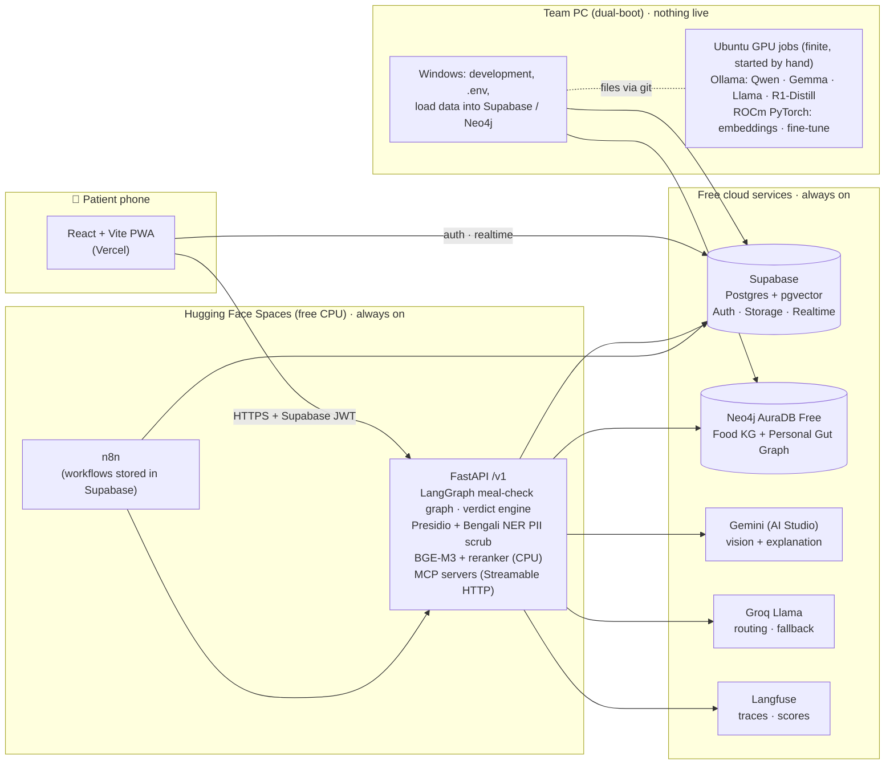
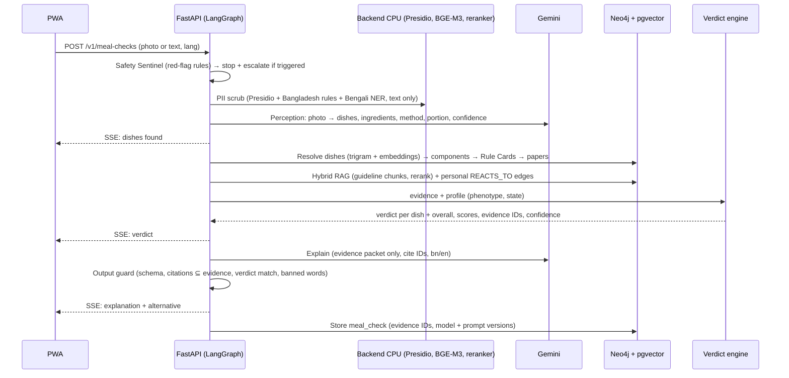

# Step 2: Architecture and stack

> Status: **v1.0** (2026-10-21). Scope is the preliminary prototype (tiers A and B in `docs/portal/submission-scope.md`). Rules: `.specify/memory/constitution.md`.

## 1. System overview



**The live app runs entirely on always-on cloud services.** The team has one dual-boot PC. On **Windows** it's used for development, secrets and loading data. On **Ubuntu** it runs finite GPU jobs that are started by hand and finish on their own: contextual headers, Bangla aliases, corpus embeddings, synthetic test sets, evaluation judging and fine-tuning. GPU jobs read their inputs from git and commit their outputs back as versioned files, so Ubuntu needs no secrets.

**The live app never depends on the GPU machine.** Everything a judge or user touches runs on always-on free services. The GPU machine (dual-boot, usually off) does batch work when it's switched on: building the knowledge layer, evaluations, synthetic data and fine-tuning. While it's online, the backend also uses it for an extra Bangla-aware PII pass and as a local fallback model.

## 2. Meal-check request flow (the hero flow)



The whole path runs on always-on services. If a Gemini free-tier quota runs out, Groq takes over.

## 3. Verdict engine (`engine/`, pure Python, no network)

**Inputs**
- Resolved dishes, each with components and levels (`none`, `low`, `medium`, `high`)
- Applicable Rule Cards: (component, phenotype, disease state) → severity 0–3, `hard` flag, citation
- Personal posteriors per component: P(trigger), credible interval, number of exposures
- Profile: diagnosis (CD / UC), phenotype (incl. stricturing), state (remission / flare)
- Confidences from perception and dish resolution

**Algorithm (v0)**
1. Hard rules first. A `hard` Rule Card match (e.g. stricturing + insoluble fibre ≥ medium) → 🔴, and the reason is fixed.
2. Guideline score per component = severity × level weight (low 0.4, medium 0.7, high 1.0) × state multiplier (flare 1.3, remission 1.0).
3. Personal score per component = P(trigger) when exposures ≥ 3; otherwise the prior is used, at reduced weight.
4. Component risk = max(guideline score / 3, personal score). Dish risk = max over its components. Meal = max over dishes.
5. Thresholds: < 0.35 🟢 · 0.35–0.65 🟡 · > 0.65 🔴.
6. Confidence = min(perception confidence, resolution confidence, evidence coverage). Below 0.5 → ⚪ "Not sure" plus a clarifying question.
7. Output: verdict, per-component contributions (for the evidence bar), evidence IDs, and the gentler alternative (lowest-risk `GENTLER_ALTERNATIVE` dish).

All weights and thresholds live in one versioned config file. Every branch has a unit test.

## 4. Repository layout

```
apps/web/            React + Vite PWA (Lovable syncs here)
services/api/        FastAPI app, LangGraph graph, Pydantic-AI agent nodes
services/mcp/        FastMCP servers: foodgraph, guidelines, journal, evals, research
engine/              Verdict engine + Trigger Discovery (pure Python, unit-tested)
pipelines/           Knowledge build: crawl → parse → resolve → enrich → load
evals/               Test sets, promptfoo config, Ragas runs, Streamlit Eval Lab
prompts/runtime/     Versioned runtime prompts (id, version, model, schema)
data/                Raw / bronze files (gitignored), seeds (committed)
specs/               Spec-Kit feature specs (spec, plan, tasks)
docs/                Strategy, data, architecture, portal texts
docker-compose.yml   optional local n8n for development
```

## 5. Interfaces
- REST `/v1` (OpenAPI):
  - `POST /meal-checks` (SSE)
  - `GET /meal-checks/{id}`
  - `POST /meal-checks/{id}/feedback`
  - `POST /checkins` (the nightly diary: foods, reactions, stool, sleep, stress, doses)
  - `GET /insights/triggers`
  - `GET /insights/flare-risk`
  - `GET /insights/patterns` (Flare Pattern Finder, spec 003)
  - `GET /insights/periods` (remission / flare timeline and per-period summaries, spec 003)
  - `POST /stress-periods`
  - `POST /reports/previsit`
  - `GET /foods/search`
  - `GET /health`
- Auth: Supabase JWT verified in FastAPI; row-level security in Postgres as a second line.
- MCP: read-only tools only; Streamable HTTP served by the backend on Hugging Face Spaces with a bearer token.

## 6. Decision log

| # | Decision | Why | Alternatives rejected |
|---|---|---|---|
| AR1 | React + Vite PWA, not Next.js | Lovable generates React + Vite; no server rendering needed | Next.js (adds a server, doesn't match Lovable) |
| AR2 | FastAPI in Docker on Hugging Face Spaces | Free with no card, sleeps only after long idle; keeps the app up when the GPU machine is off | Render (slow cold starts), the GPU machine (single point of failure), Google Cloud Run (needs a card) |
| AR3 | ~~GPU services via Tailscale Funnel behind a Caddy API-key gateway~~ superseded by AR14 | Free, no card, stable `*.ts.net` address; Ollama has no built-in auth | Cloudflare named tunnel (needs a paid domain), quick tunnels (URL changes on restart) |
| AR4 | Deterministic verdict engine as a separate package | Safety, testability, explainability (Constitution III) | LLM-decided verdicts |
| AR5 | LangGraph + Pydantic-AI | Graph control flow + typed agent nodes; one interface to Gemini, Groq and Ollama | CrewAI / AutoGen as the main orchestrator |
| AR6 | LiteLLM router with cross-provider fallback | Free-tier quotas run out; routing keeps the demo alive | Single provider |
| AR7 | Supabase for Postgres, vectors, auth, storage, realtime | One free service instead of five | Separate vector DB, auth provider, object store |
| AR8 | Neo4j AuraDB Free for the knowledge graph | Graph RAG and the Personal Gut Graph need real graph traversal | Recursive SQL over tables |
| AR9 | ~50 dishes and ~25 Rule Cards for the prototype | 10 days left; depth and correctness beat breadth | 150 dishes |
| AR10 | ~~Degraded mode when the GPU machine is offline~~ superseded by AR12 | — | — |
| AR11 | ~~(superseded by AR14)~~ GPU machine is an AMD RX 7700 XT on Ubuntu with ROCm already installed: native Ollama (incl. BGE-M3 embeddings) and a native rerank service on ROCm PyTorch; only the gateway and n8n run in Docker (gateway uses host networking, localhost-only) | Reuses the working native ROCm stack; avoids GPU passthrough into containers | Ollama ROCm container; CPU reranker |
| AR12 | Cloud-first runtime: backend, PII scrub (Presidio + Bangladesh rules), BGE-M3 query embeddings, reranker, foodgraph MCP and n8n run on always-on free services (HF Spaces + Supabase). The GPU machine is for batch jobs and an optional enhanced mode | The GPU machine dual-boots and is usually off; judges test the live link at any time | Keeping the PC on Ubuntu 24/7 |
| AR13 | One embedding implementation everywhere: BGE-M3 via sentence-transformers (GPU for batch corpus embedding, CPU for live queries) | Corpus and query vectors must come from the same model build; Ollama's quantized `bge-m3` would differ | Ollama `bge-m3` for the corpus |
| AR14 | The local GPU is never a server. The live app runs on cloud services; Tailscale Funnel and the Caddy gateway are dropped. PII scrubbing uses Presidio + Bangladesh rules + an open-source Bengali NER model on CPU | The PC dual-boots and is usually on Windows | Using the GPU as an always-on or on-demand server |
| AR15 | Windows for development, secrets and data loading; Ubuntu only for finite GPU jobs (Ollama, ROCm PyTorch). Jobs exchange inputs/outputs as versioned files in git (`data/gpu_jobs/`), so Ubuntu holds no `.env`; only Hugging Face login for pushing the fine-tuned model | One PC; keep secrets in one place; every GPU output is reproducible and reviewable | `.env` on both systems; shared NTFS folder |
